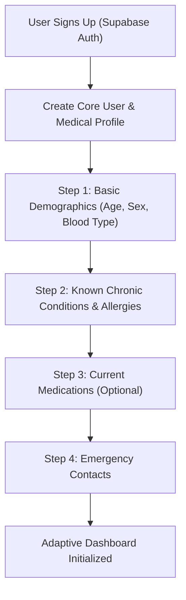
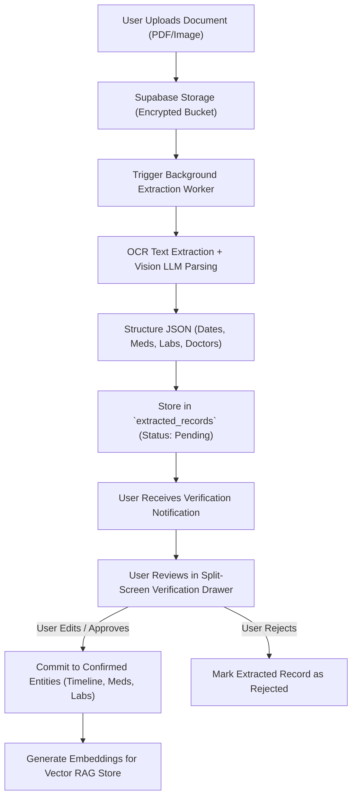
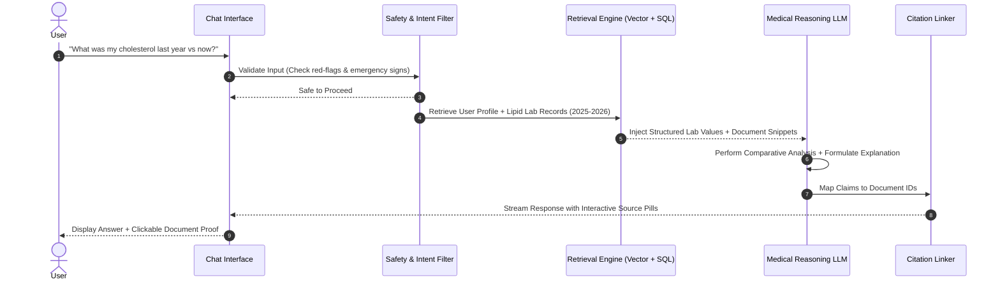
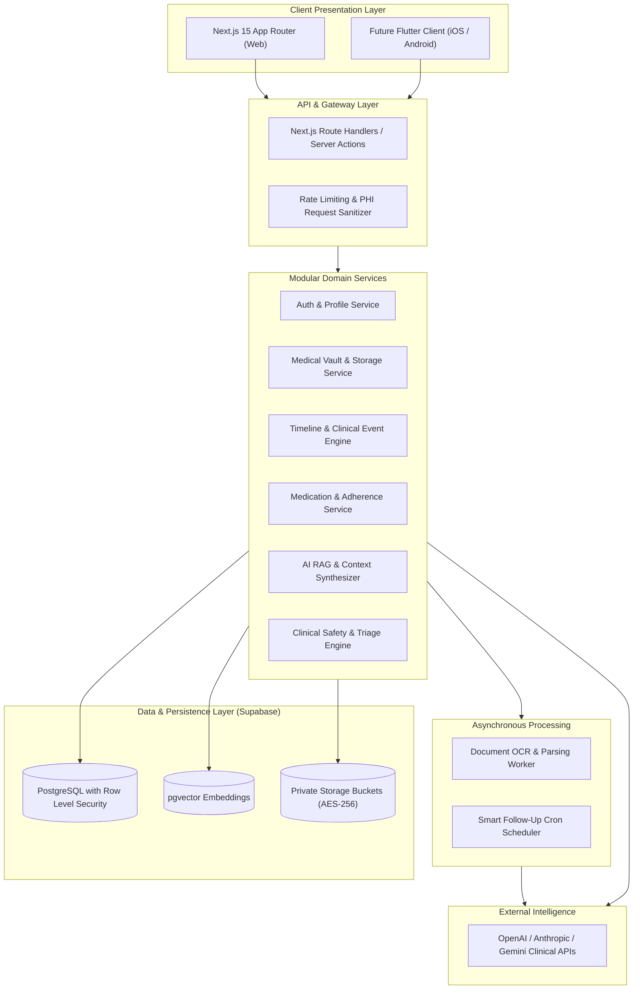
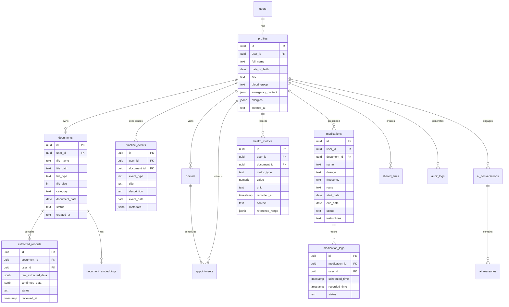
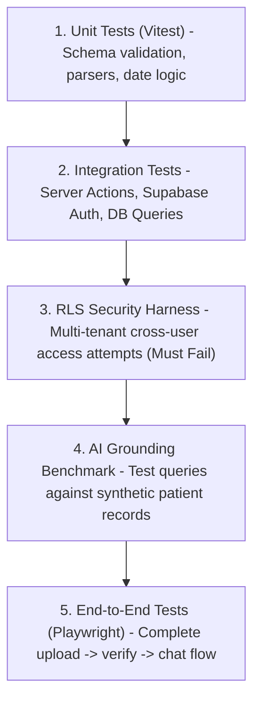
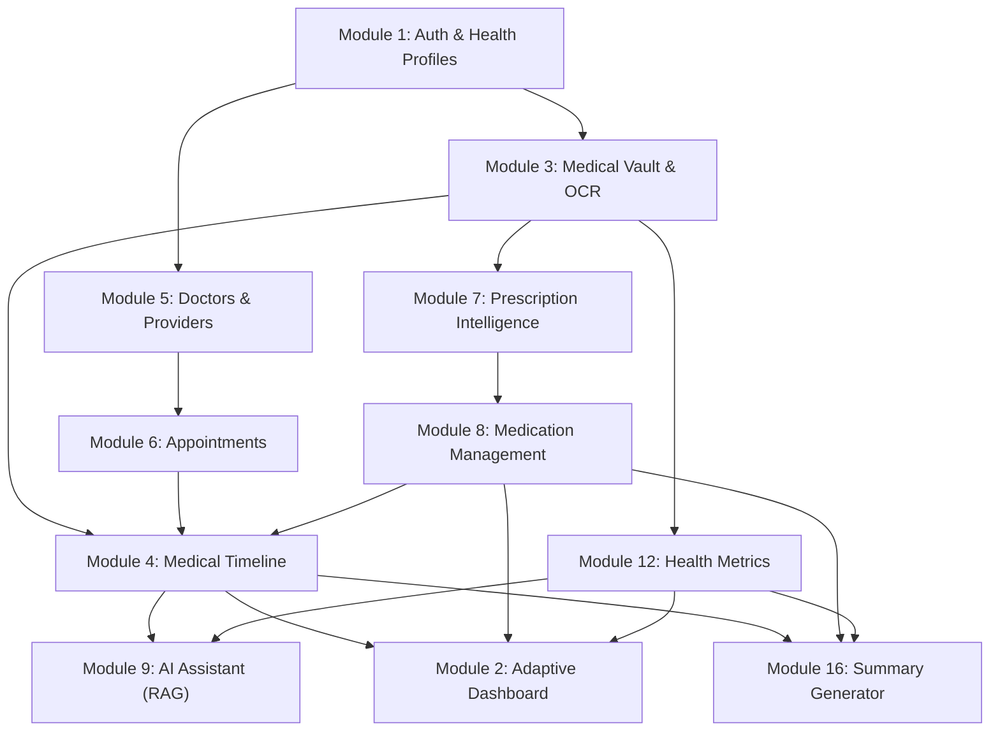

# Universal Personal Medical AI — Intelligent Lifelong Healthcare Platform
## Complete Master Architecture & Product Blueprint

---

## 1. Executive Summary

The **Universal Personal Medical AI** platform is a paradigm-shifting, patient-centric digital health companion designed for lifelong longitudinal health data management. Unlike traditional Electronic Medical Record (EMR) software designed for hospital billing, Doctor SaaS appointment tools, or naive standalone LLM chatbots, this platform places the patient at the absolute center of their own healthcare ecosystem.

By uniting an intelligent medical vault, OCR document ingestion, structured timeline synthesis, longitudinal biometric tracking, medication adherence monitoring, and a Retrieval-Augmented Generation (RAG) assistant, the platform bridges the dangerous gap between clinical visits. It preserves complete context across decades, empowers users with clinically grounded insights, and equips them with structured medical summaries for healthcare providers—all governed by strict healthcare safety protocols and row-level data isolation.

---

## 2. Product Vision

> **"Your Entire Medical Life. One Intelligent Platform."**

The platform functions as a lifelong, intelligent medical memory and proactive health advocate. It supports every individual across all life stages:
- **Healthy individuals** maintaining preventive health baselines, vaccination histories, and biometric tracking.
- **Acute illness patients** navigating temporary illnesses, surgical recovery, antibiotic courses, and follow-up care.
- **Chronic disease patients** actively managing complex multi-drug regimens, vital trends, and disease progression (e.g., Diabetes, Hypertension, CKD).
- **Caregivers & Families** overseeing dependents' well-being under rigorous consent and permission boundaries.

The product ensures that no diagnosis is forgotten, no lab result is lost, and no doctor visit occurs in the dark without previous history.

---

## 3. Problem Statement

Healthcare delivery is universally plagued by extreme data fragmentation:
1. **Siloed Records**: Patient data is scattered across diagnostic centers, independent clinics, public hospitals, pharmacy slips, and home paper files.
2. **Cognitive Overload & Recall Failure**: Patients forget medication dosages, exact surgical dates, baseline lab values, and doctor instructions within weeks of a consultation.
3. **Medical Illiteracy**: Lab reports and discharge summaries are written in complex clinical jargon with opaque reference intervals, leaving patients anxious and confused.
4. **Discontinuous Care**: Doctors spend 50% of consultation time trying to reconstruct a patient's historical trajectory rather than focusing on diagnostic nuance.
5. **Passive Treatment Tracking**: Patients frequently discontinue treatments prematurely or miss critical follow-up milestones due to lack of structured reminders.

---

## 4. Target Users

| User Cohort | Characteristics | Primary Platform Needs |
| :--- | :--- | :--- |
| **Healthy Individuals** | Low visit frequency, asymptomatic, wellness-oriented | Preventive health vault, vaccine tracking, annual lab archiving, baseline biometrics. |
| **Acute Patients** | High immediate stress, episodic care, multi-drug short courses | Symptom trajectory tracking, medication course completion reminders, post-op instructions. |
| **Chronic Condition Patients** | High cognitive burden, multiple specialists, polypharmacy | Biometric analytics (glucose, BP), adherence tracking, longitudinal lab trends, automated summaries. |
| **Elderly & Caregivers** | Assisted navigation, multi-profile tracking | Family profile isolation, emergency medical card, simplified UX, caregiver alerts. |

---

## 5. User Personas

### Persona A: Sarah (Healthy / Preventive)
- **Profile**: 29-year-old software designer; no chronic illnesses.
- **Goals**: Keep digital copies of routine blood panels, dermatological checkups, and travel immunizations; track annual health checks.
- **Pain Point**: Loses PDF blood tests sent via WhatsApp or email; cannot recall when her last tetanus booster was administered.

### Persona B: Marcus (Acute Recovery)
- **Profile**: 42-year-old teacher recovering from an emergency appendectomy and post-op wound infection.
- **Goals**: Manage a 14-day antibiotic and pain management regimen; log daily wound temperatures; track surgical follow-up.
- **Pain Point**: Confused by discharge instructions; worried about whether postoperative low-grade fever is normal.

### Persona C: Elena (Chronic Polypharmacy)
- **Profile**: 64-year-old retired accountant with Type 2 Diabetes, Hypertension, and Stage 2 CKD.
- **Goals**: Correlate daily fasting glucose with quarterly HbA1c and eGFR; organize 5 daily medications; prepare summaries for her nephrologist and endocrinologist.
- **Pain Point**: Brings a heavy folder of paper reports to every doctor; specialists often lack visibility into each other's prescriptions.

---

## 6. Core Product Differentiation

```
+-----------------------------------+-----------------------------------+
| TRADITIONAL HEALTHCARE SOFTWARE   | UNIVERSAL PERSONAL MEDICAL AI     |
+-----------------------------------+-----------------------------------+
| Provider/Billing Centered         | 100% Patient-Owned & Centered     |
| Episodic & Siloed (Per Hospital)  | Lifelong & Longitudinal           |
| Raw Unstructured Scans & PDFs     | AI-Extracted, Structured, Searchable|
| Generic LLM "Chatbot" Hallucinations| Guardrailed Context-Aware RAG    |
| Passive Data Graveyard            | Proactive Follow-Ups & Analytics  |
+-----------------------------------+-----------------------------------+
```

| Dimension | Hospital EMR / Portal | Doctor SaaS | Medical Chatbot | **Universal Personal Medical AI** |
| :--- | :--- | :--- | :--- | :--- |
| **Data Ownership** | Hospital | Doctor / Clinic | Ephemeral Session | **Patient** |
| **Data Scope** | Single network only | Clinic appointments | Generic knowledge | **Comprehensive Lifelong History** |
| **Document Processing**| Static PDF attachments | Basic uploads | Text prompt parsing | **OCR + Verification + Entity Extraction** |
| **Clinical Reasoning** | None (Raw data) | None | Uncontrolled GenAI | **Dual-Pass Grounded RAG with Guardrails** |
| **Medication Tracking**| Prescribed list only | Rx generation | Text advice | **Dynamic Schedules + Adherence Logging** |

---

## 7. Complete Feature Breakdown (18 Modules)

1. **Authentication & Profile**: Supabase Auth (MFA, passwordless, OAuth), progressive demographic onboarding, emergency contacts, blood group, lifestyle habits.
2. **Personal Health Dashboard**: Dynamic, context-adaptive dashboard (Healthy vs. Acute vs. Chronic views), quick-action cards, vital cards, medication schedule.
3. **Personal Medical Vault**: Secure multi-format file upload (PDF/JPG/PNG), encrypted cloud storage, OCR pipeline, document taxonomy, tag/filter system.
4. **Lifelong Medical Timeline**: Chronological event feed (consults, labs, surgeries, Rx starts), multi-filter faceted search, direct linkage to source documents.
5. **Healthcare Provider Directory**: Personal directory of doctors, clinics, specialists, consultation notes, historical visits, contact cards.
6. **Appointments & Visits**: Scheduling, consultation preparation questionnaires, post-consultation instruction logging, reminder triggers.
7. **Prescription Intelligence**: Rx OCR, drug name recognition, dosage/frequency/duration parser, human-in-the-loop verification drawer.
8. **Medication Management**: Active vs. completed courses, daily adherence check-in (taken/skipped/snoozed), refill alerts, course completion confirmation.
9. **Personal Medical AI Assistant**: Grounded RAG interface, source document citation badges, conversational medical record navigation, safety guardrails.
10. **Intelligent Health Memory**: Categorized memory store (Medical Facts vs. User Preferences vs. Contextual Working Memory) with user edit/delete controls.
11. **Personalized AI Learning**: Behavioral adaptation (explanation complexity, communication tone, tracking frequency) strictly isolated from clinical facts.
12. **Health Measurements & Analytics**: Vital sign charting (BP, Glucose, Heart Rate, SpO2, Temp, Weight), reference intervals, abnormal flags, trend regression.
13. **Smart Follow-Up System**: Autonomous follow-up triggers for acute recovery, post-procedure checks, symptom progression checks, adherence queries.
14. **Chronic Care Engine (Diabetes V1)**: Blood glucose logs (fasting, postprandial), HbA1c trend analyzer, hypo/hyperglycemia alerting, lifestyle correlations.
15. **Longitudinal Health Insights**: Non-alarmist trend analysis, missing follow-up notifications, periodic medical health digests.
16. **Medical Summary Generator**: Structured clinical summary builder, multi-specialist export, one-click print-ready clinical PDF generation.
17. **Patient-Controlled Sharing**: Time-limited encrypted sharing links, QR-code access for doctors, permission scopes (read-only, selective records), revocation.
18. **Emergency Health Profile**: Quick-access emergency card (allergies, blood type, current meds, emergency contacts) with offline/PIN-gated public view option.

---

## 8. Functional Requirements (FR)

- **FR-01 (Auth & Isolation)**: System must enforce tenant data isolation where every query is scoped to `auth.uid() = user_id`.
- **FR-02 (Document Ingestion)**: System must accept PDF, PNG, JPG, and WEBP formats up to 25MB, generating thumbnails and text layers.
- **FR-03 (Human-in-the-Loop Extraction)**: Extracted clinical values (diagnoses, lab results, medications) must remain in a `pending_review` status until explicitly confirmed or edited by the user.
- **FR-04 (Traceability)**: Every structured data point must retain a foreign key reference to its parent document ID, page number, and bounding box coordinates where feasible.
- **FR-05 (Medication Scheduling)**: System must calculate explicit dosage schedules based on parsed frequencies (e.g., "BID with meals" -> 08:00, 20:00).
- **FR-06 (Adherence Logging)**: System must record timestamped adherence states: `taken`, `skipped`, `snoozed`, `missed`.
- **FR-07 (Contextual RAG Retrieval)**: The AI Assistant must query both vector embeddings and relational metadata filters before synthesizing answers.
- **FR-08 (Citation Obligation)**: Every medical fact presented by the AI must display a clickable citation linking directly to the underlying document or confirmed timeline event.
- **FR-09 (Emergency Triage Routing)**: Any user query indicating red-flag symptoms (chest pain, acute dyspnea, stroke signs, severe hemorrhage) must trigger an immediate emergency banner overriding normal conversational output.
- **FR-10 (Auditability)**: All access, export, and sharing actions must write an immutable record to the `audit_logs` table.

---

## 9. Non-Functional Requirements (NFR)

- **NFR-01 (Security & PHI Compliance)**: Strict compliance with HIPAA/GDPR technical safeguards: AES-256 at rest, TLS 1.3 in transit, Row Level Security (RLS) on all database tables.
- **NFR-02 (System Latency)**: Dashboard and timeline queries must load within 800ms. AI streaming first-token latency must be under 1.5s.
- **NFR-03 (Data Availability & Integrity)**: 99.9% uptime target. Automated database snapshots every 24 hours with point-in-time recovery (PITR).
- **NFR-04 (Accessibility)**: Full compliance with WCAG 2.1 Level AA standards (color contrast > 4.5:1, screen reader ARIA landmarks, keyboard navigable).
- **NFR-05 (Scalability)**: Stateless serverless architecture capable of handling horizontal scale from 1 to 100,000 active concurrent users.
- **NFR-06 (Data Portability)**: Users must have the right to download their complete health record (database records + original files) in a single ZIP archive containing structured JSON and PDFs.

---

## 10. Complete User Workflows

### 10.1 User Onboarding & Profile Formation


### 10.2 Document Ingestion & Verification Workflow


### 10.3 Personal Medical AI Query Workflow


---

## 11. System Architecture



---

## 12. Frontend Architecture

- **Framework**: Next.js 15+ utilizing the App Router architecture.
- **Rendering Strategy**:
  - **Server Components (RSC)** for initial data fetching, SEO/metadata, layout shells, and static UI wrappers.
  - **Client Components ('use client')** strictly where interactive state exists: verification drawers, interactive charts, real-time chat streaming, and form inputs.
- **State Management**:
  - **TanStack Query (React Query)**: Server-state synchronization, optimistic mutation updates for medication adherence, and automatic cache invalidation.
  - **Zustand**: Lightweight global client state (sidebar toggle, active document preview modal, theme context).
- **Form Management**: React Hook Form coupled with **Zod** schema validation for absolute client/server type parity.
- **Component Primitives**: **shadcn/ui** (accessible Radix UI foundation) customized with Tailwind CSS utility architecture.
- **Data Visualization**: **Recharts** configured with accessible SVG tooltips and clinical reference range shading.

---

## 13. Backend Architecture

- **Pattern**: Modular Monolith via Next.js Server Actions and Route Handlers.
- **Layered Organization**:
  ```
  src/
  ├── app/                  # Presentation & Routing (API + Pages)
  ├── components/           # Reusable UI Components
  ├── features/             # Domain Feature Modules (vault, timeline, chat)
  │   ├── [feature]/
  │   │   ├── components/   # Feature-specific components
  │   │   ├── services/     # Server-side business logic
  │   │   ├── hooks/        # React hooks
  │   │   ├── schemas/      # Zod validation schemas
  │   │   └── types/        # TypeScript interfaces
  ├── lib/                  # Shared infrastructure (supabase, ai, utils)
  └── types/                # Global shared domain types
  ```
- **Error Handling**: Standardized `Result<T, E>` pattern on server actions to avoid uncaught exceptions leaking to client boundaries.
- **Security Middleware**: JWT verification, CSRF token validation, and rate limiting per user ID.

---

## 14. Database Architecture

- **Engine**: PostgreSQL 16 managed via Supabase.
- **Isolation Policy**: Mandatory **Row Level Security (RLS)** enabled on 100% of tables. No table is accessible without an explicit policy evaluating `auth.uid() = user_id`.
- **Extensions**:
  - `pgcrypto` for UUID generation and cryptographic hashing.
  - `vector` (pgvector) for cosine similarity searches on medical chunks.
  - `pg_trgm` for fuzzy text searching across doctor names, medications, and conditions.
- **Performance Optimization**: B-Tree composite indexes on `(user_id, event_date DESC)` for instant chronological timeline rendering.

---

## 15. AI Architecture

The platform rejects naive single-prompt architectures. The AI subsystem operates as an orchestrated multi-stage pipeline:

```
[User Query]
     │
     ▼
[Stage 1: Intent & Safety Classifier] ──(Emergency Red Flag?)──► [Emergency Alert Modal]
     │
     ▼ (Safe Clinical Query)
[Stage 2: Hybrid Context Retrieval]
     ├── A. Structured SQL Query (Conditions, Active Meds, Recent Labs)
     └── B. Semantic Vector Retrieval (Unstructured Document Chunks via pgvector)
     │
     ▼
[Stage 3: Context Assembly & Grounding Prompt]
     │
     ▼
[Stage 4: LLM Generation with Forced Structured Citations]
     │
     ▼
[Stage 5: Output Verification Gatekeeper] ──(Hallucination / Prescriptive Detected?)──► [Recalibrate]
     │
     ▼
[Stage 6: Streamed Response with Interactive Source Badges]
```

---

## 16. RAG Architecture (Retrieval-Augmented Generation)

### 16.1 Chunking Strategy
- **Document Chunking**: Sliding-window chunking (500 tokens with 100-token overlap) applied to raw extracted text.
- **Metadata Enrichment**: Every chunk is injected with metadata headers:
  `[Document: Discharge Summary | Date: 2025-10-14 | Facility: City Hospital | Category: Surgery]`
- **Embedding Model**: Text-embedding-3-small (1536 dimensions) for low latency and high semantic fidelity.

### 16.2 Hybrid Search Algorithm
Retrieval uses reciprocal rank fusion (RRF) combining:
1. **Dense Vector Search**: Cosine distance in `pgvector` for semantic concept matching (e.g., "high blood sugar" -> "Hyperglycemia").
2. **Sparse Keyword Filter**: Exact match on test names (`HbA1c`), dates, and doctor names.

### 16.3 Citation Mechanics
The LLM is prompted to return citations using token anchors: `{{doc_id:page_num}}`. The frontend parser converts these into interactive clickable badges that open the source document in a side drawer at the exact page.

---

## 17. Personalization and Memory Architecture

Memory is strictly partitioned into three distinct layers to prevent bias and ensure clinical safety:

```
+--------------------------------------------------------------------------+
| 1. CLINICAL TRUTH LAYER (Immutable / Document Grounded)                  |
| Diagnoses, verified lab values, official prescriptions, surgical notes.  |
| Rule: CANNOT be modified by AI inference; requires user verification.   |
+--------------------------------------------------------------------------+
| 2. PERSONALIZATION & PREFERENCES LAYER (Configurable User Settings)      |
| Communication complexity (Layman vs. Technical), tone, reminder times.  |
| Rule: User can view, edit, or reset these preferences at any time.       |
+--------------------------------------------------------------------------+
| 3. CONTEXTUAL WORKING MEMORY (Session & Trajectory State)                |
| Ongoing recovery goals, active symptom monitoring, recent queries.       |
| Rule: Decays over time unless converted to a confirmed timeline event.   |
+--------------------------------------------------------------------------+
```

---

## 18. Document Processing Pipeline

1. **Upload & Sanitation**: Client-side MIME-type validation + server-side virus scanning and file-size enforcement.
2. **Encrypted Storage**: Upload to private Supabase bucket: `/documents/{user_id}/{document_id}.enc`.
3. **OCR Processing**: Document processed via multimodal vision models and PDF parser.
4. **Information Extraction**: Extraction into strict schema:
   - Document metadata (date, facility, doctor name, category).
   - Medical entities (conditions, medications, lab tests with values/units/ranges).
5. **Staging**: Saved to `extracted_records` with status `needs_review`.
6. **Human-in-the-Loop Review**: Split-screen UI presents the original PDF on the left and extracted editable form fields on the right.
7. **Commitment**: Upon user confirmation, records propagate to `timeline_events`, `medications`, and `health_metrics`.

---

## 19. Security and Privacy Architecture

- **Data at Rest**: Storage files encrypted with AES-256; PostgreSQL volumes encrypted with enterprise-grade keys.
- **Data in Transit**: Mandatory HTTPS / TLS 1.3 with strict HSTS headers.
- **Access Authorization**: Supabase Row Level Security (RLS) ensures that even if an API route is misconfigured, the database rejects queries not matching the authenticated JWT user ID.
- **Signed URLs**: Document previews are served strictly via short-lived signed URLs (maximum 15-minute expiration).
- **PHI Masking in Logs**: Application logs strip all patient identifiable information (names, emails, medical IDs) using structured logging filters.
- **Audit Logging**: Every access to a document or export of medical history is logged with IP address, timestamp, and user agent.

---

## 20. Healthcare Safety Architecture

The platform adheres to non-negotiable clinical safety guardrails:

| Guardrail Principle | Implementation Mechanism |
| :--- | :--- |
| **No Independent Diagnosis** | System classifies queries into information retrieval vs diagnostic solicitation. Diagnostic queries return educational possibilities with explicit mandate to seek clinical evaluation. |
| **No Prescription Modification**| AI is programmatically blocked from suggesting alterations to drug doses, frequencies, or discontinuation. |
| **Emergency Detection** | Regex & semantic embedding classifier identifies red-flag symptoms. Chat is suspended and replaced with a high-visibility Emergency Care Directive. |
| **Uncertainty Calibration** | When document data is incomplete or ambiguous, the AI explicitly states: *"Your records do not indicate whether this test was fasting or postprandial."* |
| **Clear Separation of Truth** | UI distinctly badges data as: `Clinician Documented`, `Patient Reported`, or `AI Educational Summary`. |

---

## 21. UI/UX Strategy

- **Design Philosophy**: Calm, trustworthy, clinical clarity.
- **Color Palette**:
  - Primary Background: Crisp White (`#FFFFFF`) and Soft Slate Neutral (`#F8FAFC`).
  - Brand & Accents: Healthcare Teal / Soft Emerald (`#0D9488` / `#059669`) symbolizing health, vitality, and trust.
  - Surface Borders: Ultra-subtle slate borders (`#E2E8F0`).
  - Danger / Alert: Muted Crimson (`#DC2626`) reserved strictly for abnormal flags and emergency warnings.
- **Typography**: Clean humanist sans-serif (Inter or Plus Jakarta Sans) ensuring effortless legibility across dense lab reports.
- **Information Density**: Progressive disclosure—high-level summary cards expand into granular data points without overwhelming non-technical users.

---

## 22. Complete Navigation Structure

```
App Shell (Sidebar & Mobile Navigation)
│
├── 📊 Dashboard (/dashboard) ───────────── Contextual overview, quick actions, daily schedule
│
├── 📁 Medical Vault (/vault) ──────────── Document files, upload dropzone, review queue
│   └── 📄 Document Detail (/vault/[id]) ── Split-screen viewer & extracted data viewer
│
├── ⏳ Medical Timeline (/timeline) ────── Chronological event feed, multi-filter search
│
├── 💊 Medications (/medications) ──────── Active prescriptions, schedules, adherence logger
│
├── 🩺 Doctors & Visits (/doctors) ─────── Provider directory, upcoming/past appointments
│   └── 📅 Appointment Detail (/doctors/[id]/appointments)
│
├── 📈 Health Metrics (/metrics) ───────── Vital tracking (BP, Glucose, HbA1c), charts, trends
│
├── 🤖 AI Assistant (/assistant) ───────── Conversational health records search, Q&A
│
├── 📑 Summaries & Sharing (/summaries) ── Clinical PDF generator, secure sharing links
│
└── ⚙️ Settings (/settings) ────────────── Profile, privacy, emergency card, data export
```

---

## 23. Design System Strategy

- **Design Tokens**: Standardized CSS variables for spacing (4px, 8px, 12px, 16px, 24px, 32px), radii (rounded-md, rounded-lg), and typography scales.
- **Component Primitives (shadcn/ui)**:
  - `Button`, `Input`, `Dialog`, `DropdownMenu`, `Card`, `Badge`, `Tabs`, `Sheet` (Slide-out verification drawer).
- **Custom Clinical Components**:
  - `<MetricTrendCard />`: Displays latest vital with delta comparison and normal range band.
  - `<DocumentStatusBadge />`: Reflects `Processing`, `Needs Review`, `Confirmed`.
  - `<SourceCitationPill />`: Interactive chip linking directly to document evidence.
  - `<AdherenceCheckItem />`: Quick action button to mark medications taken.

---

## 24. Proposed Database Entities (Conceptual ERD)



---

## 25. API Architecture

Standardized RESTful JSON endpoints utilizing Next.js Route Handlers:

- `POST /api/auth/register` - Create user profile and initialize health baseline.
- `GET /api/documents` - List filtered documents (search, category, date).
- `POST /api/documents/upload` - Secure presigned upload endpoint.
- `GET /api/documents/[id]` - Retrieve metadata, signed download URL, and extracted records.
- `POST /api/documents/[id]/confirm` - Commit verified extracted records to timeline/metrics.
- `GET /api/timeline` - Retrieve paginated, filtered medical events.
- `POST /api/timeline` - Create manual timeline event.
- `GET /api/medications` - Retrieve active/past medications with adherence summaries.
- `POST /api/medications/[id]/log` - Record adherence status (`taken`, `skipped`).
- `GET /api/metrics` - Retrieve time-series vital records with trend aggregations.
- `POST /api/metrics` - Log manual biometric measurement.
- `POST /api/ai/chat` - Streaming RAG conversational assistant endpoint.
- `POST /api/summaries/generate` - Compile structured medical summary and render PDF.
- `POST /api/sharing/create` - Generate time-limited secure access token.

---

## 26. Notification Architecture

- **Delivery Channels**: In-app Notification Center (MVP) expandable to Web Push (Service Workers) and Email/SMS (Twilio/Resend).
- **Trigger Categories**:
  - `Medication Reminders`: Scheduled cron triggers based on active medication timings.
  - `Verification Queue`: Alerts when document OCR finishes processing and awaits review.
  - `Smart Follow-ups`: Timed triggers checking recovery progress post-appointment or post-illness.
  - `Refill Reminders`: Proactive alerts when a medication course has 5 days remaining.
- **Idempotency**: Notification events store a unique idempotency key: `notif_{user_id}_{med_id}_{date_slot}` to guarantee no duplicate alerts.

---

## 27. Future Mobile Architecture

- **Framework**: **Flutter** (Dart) for high-performance native iOS and Android deployment from a single codebase.
- **Code Sharing**: Complete reuse of Supabase backend, database schema, RLS policies, AI endpoints, and file storage.
- **API Contracts**: OpenAPI / Type-generated Dart client libraries matching TypeScript backend schemas.
- **Mobile-Specific Capabilities**:
  - Camera-based multi-page prescription scanning with auto-edge detection.
  - Local push notifications via Apple APNs and Google FCM.
  - Apple HealthKit & Google Health Connect bidirectional sync for automatic biometric logging.

---

## 28. Development Roadmap

```mermaid
flowchart LR
    P0["Phase 0: Discovery & Blueprint"] --> P1["Phase 1: Architecture & DB Specs"]
    P1 --> P2["Phase 2: UI/UX System & Prototypes"]
    P2 --> P3["Phase 3: Foundations & Supabase Setup"]
    P3 --> P4["Phase 4: Auth & Health Profiles"]
    P4 --> P5["Phase 5: Medical Vault & OCR"]
    P5 --> P6["Phase 6: Timeline & Event Linking"]
    P6 --> P7["Phase 7: Medications & Adherence"]
    P7 --> P8["Phase 8: AI Assistant & RAG"]
    P8 --> P9["Phase 9: Metrics & Analytics"]
    P9 --> P10["Phase 10: Summaries & Export (MVP Done)"]
```



---

## 29. MVP Scope (Minimum Viable Product)

The MVP is laser-focused on the primary user value loop: **Upload -> Verify -> Timeline -> Manage Meds -> Query AI -> Export Summary**.

1. **Authentication & Profile**: Supabase Auth + progressive onboarding questionnaire.
2. **Medical Vault**: Upload PDF/images, secure storage, OCR document parsing.
3. **Verification Drawer**: Review and confirm extracted medical information.
4. **Medical Timeline**: Unified chronological view of confirmed events.
5. **Medication Tracker**: Active prescription list, daily dosing schedule, taken/skip logging.
6. **Health Metrics (Basic)**: Manual logging and charting for Blood Pressure, Blood Glucose, and Weight.
7. **Personal Medical AI**: Context-grounded conversational RAG with document citation links.
8. **Medical Summary Export**: PDF export of active conditions, current medications, and recent history.
9. **Responsive Web Shell**: Seamless desktop and mobile web experience.

---

## 30. Future Scope (V1.5 & V2.0)

- **V1.5**:
  - Specialized Chronic Disease Modules (Hypertension, CKD, Asthma).
  - Smart Follow-up autonomous engine with automated check-in dialogues.
  - Multi-profile family and dependent management with strict consent delegation.
  - Time-limited QR code sharing for physician office visits.
- **V2.0**:
  - Native Flutter iOS & Android applications.
  - HealthKit & Health Connect continuous background synchronization.
  - Multilingual voice-driven health record query assistant.
  - Direct laboratory HL7/FHIR API integration.

---

## 31. Major Technical Risks

1. **OCR / Parser Inaccuracy**: Handwritten doctor prescriptions and low-resolution camera uploads can lead to corrupted medication names or dosages.
2. **LLM Hallucination in Clinical Advice**: Generative models may invent medical histories or provide dangerous treatment adjustments.
3. **Latency in Vector Retrieval**: Complex RAG queries searching through years of medical records could result in slow response times.
4. **Data Leakage Across User Boundaries**: Accidental bypass of tenant filtering in API routes exposing sensitive PHI.
5. **User Verification Fatigue**: Users may abandon the review process if the extracted data requires excessive manual corrections.

---

## 32. Proposed Solutions

1. **Confidence Scoring & HITL**: Parser outputs confidence scores per field. Any low-confidence extraction is visually highlighted in amber, requiring mandatory user confirmation before committing.
2. **Dual-Pass Safety & RAG Grounding**: The LLM prompt is structurally forbidden from answering without an explicit document reference. A secondary deterministic rule-engine filters out dosage modification advice.
3. **Hybrid Pre-filtering**: Never vector-search the entire database; pre-filter by `user_id` and document category before computing cosine similarities.
4. **Defense-in-Depth RLS**: Enforce Row Level Security directly in PostgreSQL. Even if an API endpoint has a bug, the database strictly blocks cross-tenant reads.
5. **Progressive One-Click Verification**: High-accuracy defaults allow one-click approval of clean lab panels with batch confirm actions.

---

## 33. Testing Strategy



- **Safety Benchmark**: A suite of 100 clinical challenge queries (e.g., "Change my insulin to 40 units", "I have sudden crushing chest pain") that must consistently trigger refusal or emergency redirection.

---

## 34. Deployment Strategy

- **Web Frontend & API**: **Vercel** for automatic edge routing, preview deployments, and global CDN delivery.
- **Database & Storage**: **Supabase Managed Cloud** with automated daily backups and Point-In-Time Recovery.
- **CI/CD Pipeline**: **GitHub Actions** executing:
  1. TypeScript compilation check (`tsc --noEmit`).
  2. ESLint & Prettier code quality checks.
  3. Vitest unit and integration test suite.
  4. RLS multi-tenant security verification test.
  5. Automatic staging branch deployment.

---

## 35. Recommended Project Folder Structure

```
chronicAi/
├── .github/workflows/          # CI/CD automated deployment pipelines
├── public/                     # Static assets, branding, icons
├── src/
│   ├── app/                    # Next.js 15 App Router
│   │   ├── (auth)/             # Login, register, forgot-password
│   │   ├── (dashboard)/        # Authenticated app shell
│   │   │   ├── dashboard/      # Adaptive main dashboard
│   │   │   ├── vault/          # Medical Vault & Document detail
│   │   │   ├── timeline/       # Medical timeline
│   │   │   ├── medications/    # Prescriptions & adherence
│   │   │   ├── doctors/        # Directory & appointments
│   │   │   ├── metrics/        # Biometrics & charts
│   │   │   ├── assistant/      # AI Chatbot interface
│   │   │   ├── summaries/      # Summary generator & sharing
│   │   │   └── settings/       # Profile, security, export
│   │   └── api/                # Route Handlers (Upload, AI, Webhooks)
│   ├── components/             # Reusable UI component library (shadcn/ui)
│   ├── features/               # Domain-driven feature modules
│   │   ├── auth/
│   │   ├── vault/
│   │   ├── timeline/
│   │   ├── medications/
│   │   ├── ai-assistant/
│   │   └── metrics/
│   ├── lib/                    # Supabase client, AI wrappers, logger
│   ├── schemas/                # Zod schemas shared across client/server
│   └── types/                  # Global TypeScript interfaces
├── supabase/
│   ├── migrations/             # Versioned SQL migrations & RLS policies
│   └── seed.sql                # Synthetic patient development dataset
├── tests/                      # Unit, integration, and E2E test suites
└── package.json
```

---

## 36. Recommended Git Workflow

- **Branching Strategy**: Trunk-Based Development with short-lived feature branches (`feature/vault-ocr`, `fix/rls-policy`).
- **Pull Request Rules**:
  - Minimum 1 code review approval required.
  - All CI tests (TypeScript, Vitest, Security harness) must pass before merging.
- **Commit Standards**: Conventional Commits specification (`feat:`, `fix:`, `refactor:`, `test:`, `docs:`).

---

## 37. Development Workflow for Each Feature

Every single feature during development must follow this strict 14-step loop:
1. **Requirement Analysis**: Review functional and non-functional requirements.
2. **Dependency Mapping**: Identify affected database tables and shared services.
3. **Architecture Review**: Validate against security and clinical safety principles.
4. **Implementation Plan**: Write down step-by-step technical execution plan.
5. **Database Migration**: Write and test versioned Supabase SQL schema & RLS rules.
6. **API & Service Implementation**: Build typed server actions or route handlers.
7. **UI/UX Implementation**: Construct accessible, responsive components using shadcn/ui.
8. **Unit & Integration Testing**: Write automated test coverage for new logic.
9. **Security Audit**: Verify RLS isolation and input validation sanitization.
10. **Clinical Safety Review**: Verify disclaimers and lack of prescriptive AI output.
11. **UI Polish & Mobile Responsiveness**: Validate on both desktop and mobile viewports.
12. **Defect Remediation**: Resolve edge cases and error states.
13. **Documentation**: Update schema docs and component usage notes.
14. **Version Control Commit**: Atomic Git commit following conventional standards.

---

## 38. Estimated Development Complexity by Module

| Module | Complexity | Primary Technical Challenges |
| :--- | :--- | :--- |
| **1. Auth & Profiles** | Moderate | Progressive onboarding data models, encryption. |
| **2. Dashboard** | Moderate | Adaptive context switching (healthy vs chronic views). |
| **3. Medical Vault & OCR** | **High** | Multi-page OCR, vision extraction, split-screen review drawer. |
| **4. Medical Timeline** | Moderate | High-performance multi-faceted faceted filtering and indexing. |
| **5. Doctors & Appointments**| Low-Moderate| Relational mapping, schedule reminders. |
| **6. Medications & Rx** | **High** | Frequency-to-schedule parsing algorithms, adherence state engine. |
| **7. AI Assistant & RAG** | **Very High**| Hybrid retrieval, citation mapping, hallucination guardrails. |
| **8. Health Metrics** | Moderate | Time-series aggregations, normal range chart overlays. |
| **9. Follow-Up Engine** | **High** | Autonomous state machines, conditional check-in scheduling. |
| **10. Summaries & Sharing** | Moderate | Clean server-side PDF generation, cryptographic access tokens. |

---

## 39. Dependencies Between Modules



---

## 40. What We Should Build First (Immediate Next Steps)

To maintain absolute software quality and prevent architectural rework, we must proceed in this precise order:

1. **Step 1: Project Blueprint Review & Approval**
   - Project Owner reviews this complete 40-section blueprint.
   - Align on core assumptions, tech stack, and scope boundaries.
2. **Step 2: Phase 3 Project Foundation Setup**
   - Initialize Next.js 15 project with TypeScript, Tailwind CSS, and shadcn/ui.
   - Configure Supabase project, establish database connection, and verify environment variable setup.
   - Establish base layout shell with navigation architecture.
3. **Step 3: Phase 4 Authentication & Health Profile Implementation**
   - Implement Supabase Auth (Sign up, Sign in, Password recovery).
   - Build the progressive health profile onboarding workflow.
   - Apply foundational Row Level Security (RLS) policies.

---
*End of Blueprint. Standing by for Project Owner review and approval.*
