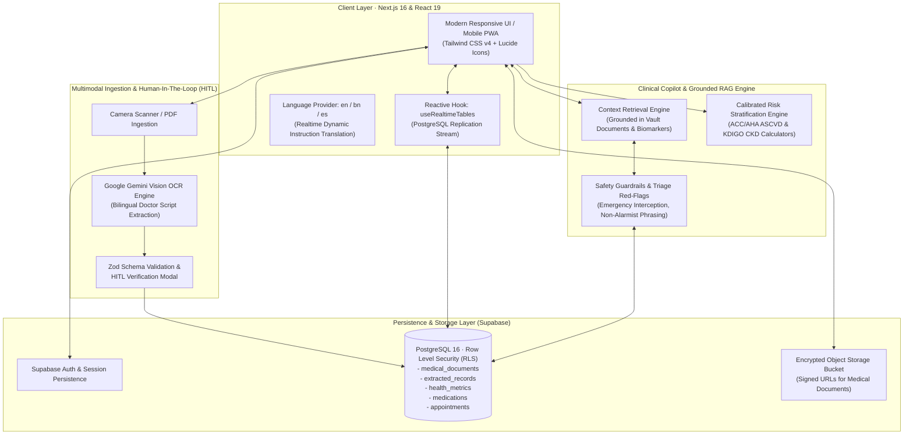

<div align="center">

# 🩺 ChronicAI · Lifelong Health Intelligence & Clinical Copilot
### *Your Entire Medical Life. Synthesized, Grounded & Patient-First.*

[](https://nextjs.org/)
[](https://react.dev/)
[](https://www.typescriptlang.org/)
[](https://supabase.com/)
[](https://deepmind.google/technologies/gemini/)
[](https://tailwindcss.com/)

<p align="center">
  <b>Production-grade personal health intelligence platform that unifies fragmented medical histories, deciphers multi-lingual handwritten prescriptions, tracks lifelong biomarkers, and delivers hallucination-resistant clinical copilot guidance grounded in real lab evidence.</b>
</p>

[Live Demo](https://chronic-ai.vercel.app) · [Key Architecture](#-system-architecture) · [Engineering Decisions](#-engineering-highlights--technical-decisions) · [Quickstart](#-getting-started) · [API Documentation](#-api-routes--serverless-endpoints)

---

</div>

## 📌 Problem & Motivation

Chronic conditions (cardiovascular disease, diabetes, hypertension, CKD, and recurring dermatological infections) account for **over 70% of global healthcare mortality**. Yet, patient management is plagued by:
1. **Paper-Based Fragmentation**: Patients carry loose prescriptions and faded laboratory printouts from disparate diagnostic centers.
2. **Ungrounded Consumer AI**: Generic LLMs hallucinate medical claims or issue frightening, alarmist population warnings to healthy young adults.
3. **Medication Non-Adherence**: Complex polypharmacy regimens (varying frequencies, topical vs oral, meal dependencies) lead to frequent therapeutic failure.
4. **Siloed Historical Trajectories**: Doctors rarely have access to longitudinal trendlines (e.g., Creatinine trajectory, HbA1c curves, or Platelet trends across years).

**ChronicAI solves this** through an end-to-end, human-in-the-loop clinical operating system designed for patients and clinicians alike.

---

## 🏗️ System Architecture



---

## ⚡ Engineering Highlights & Technical Decisions

### 1. Bilingual Multimodal Clinical OCR & Translation
* **Doctor Handwriting & Bilingual Ingestion**: Employs Google Gemini Vision to transcribe handwritten and printed prescriptions containing mixed English and Bengali instructions (e.g., *"১ + ০ + ১ ৭ দিন"*, *"খাওয়ার আধা ঘণ্টা আগে"*).
* **Smart Dynamic Regimen Translation**: Clinical instructions are parsed into normalized structured objects. When viewed in English mode, local timing instructions are dynamically translated into standard clinical terminology (*"Take 30 mins before meals · 6 Weeks"*); when in Bengali mode, native instructions are preserved.
* **Human-In-The-Loop (HITL) Verification**: Scanned records are never blindly committed. Users inspect, adjust dosages, and confirm extracted biomarkers before DB insertion.

### 2. Evidence-Based, Non-Alarmist Clinical Risk Stratification
* **Dynamic Patient Calibration**: Standard calculators (AHA/ACC 10-Yr ASCVD Risk, KDIGO eGFR CKD staging) typically default to alarming 45+ population baselines. ChronicAI automatically injects the patient's verified age (e.g. 21 y/o), measured Blood Pressure (122/78 mmHg), and Serum Creatinine (0.84 mg/dL).
* **Calibrated Guidance**: Delivers reassuring, evidence-based health guidance rather than anxiety-inducing generic warnings, linking each metric directly back to the original diagnostic vault report.

### 3. Defensive Multi-Tier Data Access & Supabase RLS
* **Strict Tenant Isolation**: PostgreSQL Row Level Security (RLS) ensures patients can strictly read and write only their own records (`auth.uid() = user_id`).
* **Zero Service Key Leakage**: Service role keys are restricted strictly to secure Server Actions and API Route handlers (`/api/medications/*`, `/api/appointments/*`, `/api/documents/*`), with zero client exposure.
* **Service Role Fallback Pattern**: Serverless API routes verify the requesting user's session JWT, perform authorization checks, and utilize admin fallback clients only when necessary for transactional integrity across audit logs and notifications.

### 4. Realtime Cross-Device State Synchronization
* **Event-Driven UI**: Built with a reactive `useRealtimeTables` hook connected to Supabase real-time replication channels.
* **Zero-Refresh Persistence**: Updating a medication's taken status or uploading a document from a mobile device instantaneously updates open dashboard tabs without manual page reloads.

### 5. Mobile-First Craftsmanship & Micro-Interactions
* **Curved Liquid-Wave Tab Bar**: Bespoke SVG path continuous dome with a 5px backdrop blur and separation border that floats flush to the screen bottom.
* **Intelligent Auto-Hiding**: Hides smoothly on downward scroll and reveals instantly on upward flick or reach-to-top.
* **Touch Gestures & Haptics**: Full horizontal swipe navigation across core tabs with spring physics and active indicators.

---

## 🧩 Core Capabilities & Features

| Module | Features & Capabilities |
|---|---|
| **Health Vault** | Secure multi-format document storage (PDFs, images) with automated categorization (`prescription`, `lab_report`, `imaging`), patient-friendly medical domain tags (Dermatology, Hematology, Nephrology), deep inspection modal, and original file downloads via encrypted signed URLs. |
| **Clinical Copilot** | Conversational medical intelligence grounded in the patient's real history, active prescriptions, and lab panels. Features red-flag emergency triage interception and mandatory citation linking. |
| **Medication Intelligence** | Active pharmaceutical schedule with 3-state adherence tracking (`Taken`, `Untaken`, `Snoozed`), daily adherence scoring, refill warnings, and drug class categorization. |
| **Screening & Risk Engine** | Personalized cardiovascular (ASCVD), renal (KDIGO eGFR), and hematology surveillance engines grounded in real diagnostic results. |
| **Longitudinal Analytics** | Multi-metric tracker for Blood Pressure, Blood Glucose, Serum Creatinine, and Platelet trends with clinical reference ranges and abnormal variance indicators. |
| **Consultations & Visits** | Full appointment lifecycle management with specialty tracking, consultation preparation notes with Copilot, rescheduling, and deletion modals. |
| **Profile & Chronic Care** | Unified patient medical passport containing blood group, emergency contacts, BMI metrics, chronic condition registries, and localized language preferences (`en`, `bn`, `es`). |

---

## 📂 Project Structure

```
chronicAi/
├── src/
│   ├── app/                                # Next.js 16 App Router Routes
│   │   ├── (auth)/                         # Login, Signup, Auth Callbacks
│   │   ├── (dashboard)/                    # Authenticated Patient Application
│   │   │   ├── appointments/               # Clinical Consultations & Doctor Booking
│   │   │   ├── assistant/                  # Clinical Copilot & Grounded RAG Chat
│   │   │   ├── chronic-care/               # Condition-Specific Care Regimens
│   │   │   ├── dashboard/                  # Unified Health Overview & Quick Actions
│   │   │   ├── medications/                # Pharmaceutical Regimen & Adherence Logging
│   │   │   ├── metrics/                    # Longitudinal Health Biometrics & Trends
│   │   │   ├── notifications/              # Clinical Alerts & Reminder Center
│   │   │   ├── profile/                    # Personal Medical Passport & Conditions
│   │   │   ├── screenings/                 # Calibrated Health Risk Calculators
│   │   │   ├── settings/                   # Theme, Depth, Language & Data Export
│   │   │   ├── timeline/                   # Chronological Longitudinal Trajectory
│   │   │   └── vault/                      # Medical Document Vault & Inspection
│   │   ├── api/                            # Secure Serverless Edge API Routes
│   │   │   ├── appointments/               # Update / Delete Consultation Handlers
│   │   │   ├── assistant/                  # RAG Clinical Stream & TTS Endpoints
│   │   │   ├── documents/                  # Document Modification & Storage Cleaners
│   │   │   ├── medications/                # High-Integrity Log & Adherence Handlers
│   │   │   ├── profile/                    # Patient Attribute Synchronization
│   │   │   └── rag/                        # Vector Embeddings & Context Retrievers
│   │   ├── layout.tsx                      # Root Application HTML & Theme Shell
│   │   └── page.tsx                        # High-Conversion Clinical Landing Page
│   ├── components/                         # Modular React Component Architecture
│   │   ├── layout/                         # DesktopNavRail, MobileTabBar, TopBar
│   │   ├── ui/                             # Buttons, Modals, Badges, Tabs
│   │   └── widgets/                        # Metric Charts, Waveforms, Status Strips
│   ├── context/                            # React Context Providers
│   │   ├── AuthContext.tsx                 # Supabase Session & Patient Identity
│   │   ├── LanguageContext.tsx             # Multi-Language Dictionary (en, bn, es)
│   │   └── ThemeContext.tsx                # Dark / Light Mode Provider
│   ├── hooks/                              # Custom React Hooks
│   │   └── useRealtime.ts                  # Reactive PostgreSQL Replication Hook
│   ├── lib/                                # Utilities & Third-Party Service Clients
│   │   ├── supabase/                       # Supabase SSR Client, Services & Storage
│   │   │   ├── client.ts                   # Browser-Side Client
│   │   │   ├── server.ts                   # Server-Side Cookie-Bound Client
│   │   │   ├── storage.ts                  # Signed URL & Bucket Storage Handlers
│   │   │   └── services/                   # Typed Domain Database Abstractions
│   │   └── utils.ts                        # Metric Formatter & Styling Helpers
│   └── types/                              # Strict TypeScript Definitions
│       ├── database.ts                     # Supabase Generated Database Schema
│       └── medical.ts                      # Clinical Enums, Documents & Regimens
├── public/                                 # Static Assets, Icons, Manifest
├── .env.example                            # Documented Environment Template
├── next.config.ts                          # Next.js Production Build Configuration
├── tailwind.config.ts                      # Tailwind Theme & Styling Definitions
└── tsconfig.json                           # Strict TypeScript Configuration
```

---

## 🚀 Getting Started

### Prerequisites
* [Node.js](https://nodejs.org/) `>= 20.0.0`
* [npm](https://www.npmjs.com/) `>= 10.0.0`
* A free [Supabase](https://supabase.com/) Account (PostgreSQL Database & Storage)
* A [Google AI Studio](https://aistudio.google.com/) API Key (for Gemini OCR & Copilot)

### 1. Clone & Install
```bash
git clone https://github.com/Naim-006/ChronicAi.git
cd ChronicAi
npm install
```

### 2. Environment Configuration
Create a `.env.local` file in the root directory:
```bash
cp .env.example .env.local
```
Fill in your credentials:
```env
NEXT_PUBLIC_SUPABASE_URL=https://your-project.supabase.co
NEXT_PUBLIC_SUPABASE_ANON_KEY=your-anon-public-key
SUPABASE_SERVICE_ROLE_KEY=your-service-role-admin-key
GEMINI_API_KEY=your-gemini-api-key
NEXT_PUBLIC_SITE_URL=http://localhost:3000
```

### 3. Run Development Server
```bash
npm run dev
```
Open [http://localhost:3000](http://localhost:3000) in your browser.

### 4. Production Build & Type-Check
```bash
npx tsc --noEmit     # Validates 100% strict TypeScript types
npm run build        # Compiles all 33 static & dynamic Next.js routes
```

---

## 🔒 Security, Privacy & Compliance Consciousness

* **Patient Data Isolation**: Row-Level Security (RLS) is enabled on all tables in PostgreSQL. No patient can query, read, or infer another user's health metrics.
* **Zero Credential Exposure**: Client-side bundles are completely stripped of administrative keys. Storage uploads and document views use short-lived, encrypted Signed URLs.
* **Non-Diagnostic Disclaimer**: Prominent, accessible clinical disclaimers in accordance with international medical software guidelines remind users that the system serves as an informational companion, not a substitute for clinical judgment.
* **Sanitized AI Prompts**: Patient identifiers are sanitized before submission to multimodal LLM endpoints to preserve patient privacy.

---

## 👨‍💻 Author & Contributions

**Naim Hossain**  
*Full-Stack Software Engineer & Clinical Systems Architect*  
* GitHub: [@Naim-006](https://github.com/Naim-006)  
* Repository: [https://github.com/Naim-006/ChronicAi.git](https://github.com/Naim-006/ChronicAi.git)

---

## 📄 License

This project is licensed under the **MIT License** — feel free to use, modify, and build upon this platform for educational, research, and non-commercial health advocacy purposes.
